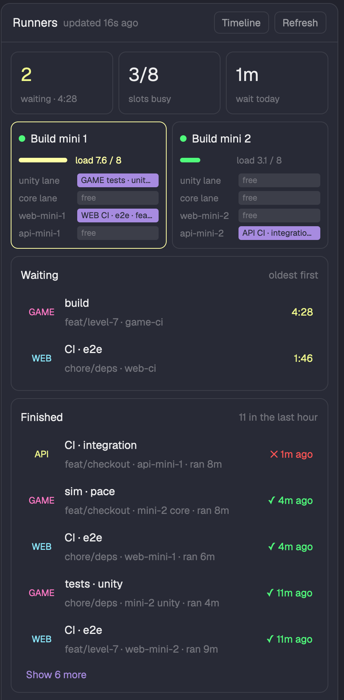
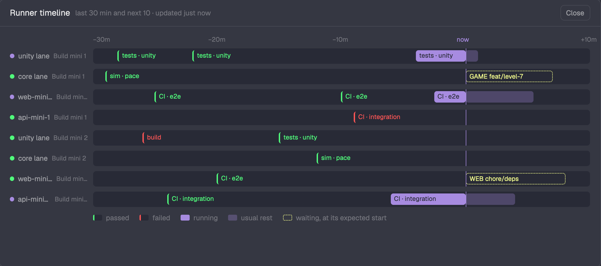

> [!IMPORTANT]
> **This mod moved to [Lakris2407/herdr-mods](https://github.com/Lakris2407/herdr-mods/tree/main/runners).** This repo is archived; new versions only ship there.

# Runners for Herdr

See what waits for your self-hosted runners and build machines, what runs on them now, and how hard
each machine works, in the [Herdr](https://herdr.dev) desktop app. Made for a couple of Mac minis
that run CI and test jobs for several coding agents at once, but it works for any self-hosted
GitHub Actions runners and any machine you can reach over ssh.



- **Status-bar chip:** a square per runner slot, grouped per machine (accent = running, grey = free,
  red = offline), and how many jobs wait. Click it to open or close the Runners panel; right-click
  it for a quick-look popup. On a narrow status bar it drops the title, then the squares, so the
  counts always show.
- **Panel** beside Files and Changes: totals, each machine with its load and slots, the waiting
  jobs (oldest first) and the jobs that finished in the last hour.
- **Timeline**, a window you open from the panel or the popup: a lane per slot over the last 30
  minutes and the next 10. Waiting jobs sit where the first free slot of their pool should take them,
  from how long each job usually takes.
- **Toasts** when a job waits longer than `waitAlertMinutes`, and when a slot goes offline.
- Click a GitHub job to open it on GitHub; click a lanes job to open its log folder.




## Sources

- **GitHub Actions self-hosted runners**, through `gh api`: the recent runs of each repo you list
  and the jobs of every run that is active or finished in the last two hours. A job is watched when
  it asks for `self-hosted` or one of your `labels`, or runs on a runner you list. Online and busy
  come from `actions/runners`; that endpoint needs repo admin, so without it a slot shows `idle?`
  until a job runs on it.
- **Machine load** over ssh: `sysctl -n vm.loadavg hw.ncpu` (macOS), the 1-minute load per core.
- **A lock-based job runner of your own (optional):** a script that runs jobs on your machines
  with a lock per lane, read through its `status` command and a history file. See
  [Lanes](#lanes).

All views share one snapshot. The first view that finds it due reads it: every 20 s while a job
waits or runs, every 60 s when idle, load every 60 s.

## Requirements

- The Herdr desktop app (`herdr-app`).
- [`gh`](https://cli.github.com), logged in (`gh auth login`), for GitHub runners.
- ssh keys that log in without a prompt (`BatchMode`), for machine load.

## Install

Or ask the agent running in Herdr: "add the herdr.dev mod Lakris2407/herdr-runners".

1. Copy `mods/runners` to `~/.config/herdr-app/mods/runners` and run
   `herdr-app check ~/.config/herdr-app/mods/runners`.
2. Herdr's own layouts and mods are read-only, so clone the layout and the tab bar:

   ```sh
   herdr-app do layout.clone '{"name":"main","as":"main-plus"}'
   herdr-app do mod.clone '{"name":"tabs","as":"tabs-plus"}'
   ```

3. In `~/.config/herdr-app/layouts/main-plus.json`, use `tabs-plus` for the `tabs` block, add the
   panel to the side panel stack (`panel-body`), and put the chip in the status row:

   ```json
   { "id": "runners", "type": "block", "content": { "mod": "runners" } }
   ```

   ```json
   { "id": "status", "type": "row", "size": { "px": 28 }, "resizable": false, "children": [
     { "id": "status-main", "type": "block", "content": { "mod": "workspace-status" }, "size": { "weight": 1 } },
     { "id": "status-runners", "type": "block", "content": { "mod": "runners", "props": { "view": "chip" } },
       "size": { "weight": 2.6 }, "min": 120 }
   ] }
   ```

   Use weights, not fixed pixels, for the status blocks: then every block gets a share at any
   window width, and each one draws less when it gets less room.
4. In `~/.config/herdr-app/mods/tabs-plus/main.js`, add `"runners"` to the enabled panels and a
   button beside the others (or use the tab-bar menu in [Extras](#extras)):

   ```js
   .child(panelButton("runners", "Runners", "mods/runners/runners.svg"))
   ```

5. Create `~/.config/herdr-app/runners.json` (below). To try the mod first, write
   `{ "demo": true }`: the panel then shows made-up machines and jobs.

## Configure: `~/.config/herdr-app/runners.json`

Nothing is built in; the mod reads only what this file lists.

```json
{
  "repos": [
    { "repo": "acme/web", "short": "WEB", "color": "ansi6" },
    { "repo": "acme/game", "short": "GAME", "color": "ansi5" }
  ],
  "machines": [
    { "name": "Build mini 1", "ssh": "me@build-mini-1.local", "lanes": "mini1", "runners": ["web-mini-1"] },
    { "name": "Build mini 2", "ssh": "me@build-mini-2.local", "lanes": "mini2", "runners": ["web-mini-2"] }
  ],
  "labels": ["web-ci"],
  "waitAlertMinutes": 5
}
```

| Key | What it does |
|---|---|
| `repos` | GitHub repos whose Actions jobs to watch. `short` is the tag on each job; `color` a theme color name (`ansi0`..`ansi15`, `accent`, ...). |
| `machines` | One card each. `ssh` (optional) reads the load. `runners` are GitHub runner names on that machine. `lanes` is the machine's name in the lanes `status` output. Runners no machine lists go under "Other runners". |
| `labels` | Extra job labels that mean "runs on my runners", for jobs that do not ask for `self-hosted`. |
| `lanes` | Optional lock-based runner, below. |
| `waitAlertMinutes` | Toast when a job waits this long (default 5). |
| `demo` | `true` shows made-up data and runs nothing. |

Keys: bind `runners.refresh` and `runners.timeline` in `keys.json`.

## Lanes

If you run jobs on your machines with a script of your own (for example one lock per machine for
Unity jobs and one for headless tests), Runners can show its lanes beside the GitHub runners:

```json
"lanes": {
  "name": "my-game", "short": "GAME", "color": "ansi5",
  "command": ["bash", "scripts/run-on-mini.sh", "status"],
  "cwd": "/path/to/repo",
  "history": "/path/to/repo/.git/runner-history.jsonl",
  "hosts": { "build-mini-1.local": "mini1" }
}
```

The `status` command prints one line per lane, then the waiting callers:

```text
mini1 unity: free
mini1 core: core tests args: -filter Fast branch: feat/x commit: 1a2b3c4 worktree: x 42s logs: /tmp/run-42
mini1 warm: idle 3 min
mini2 unity: unreachable
Waiting callers:
  waiting: unity build args:  branch: feat/y commit: 5d6e7f8 worktree: y 84s logs: /tmp/run-43
```

A lane is `free`, `busy (no details)`, `unreachable`, or runs a job: lane, job, then `args:`,
`branch:`, `commit:`, `worktree:`, the seconds it has run (`42s`) and `logs:`. A `<machine> warm:`
line shows as free text under the machine. `joined:` lines (callers waiting for an identical job)
are read but not counted as waiting. The optional history file has one JSON record per finished job:
`{ token, job, lane, host, branch, worktree, commit, args, outcome: "pass" | "fail" | ..., logs,
times: { request, lock, end } }` with times in epoch seconds; `hosts` maps `host` to a machine's
`lanes` name. History gives the Finished list, the timeline's past, and the usual length of each job.

## Extras

**Tab-bar menu:** right-click any panel button in `tabs-plus` to choose which buttons show (hide
Files and Changes if you never use them). See [`extras/tabs-plus-panel-menu.md`](extras/tabs-plus-panel-menu.md).

## What it runs

`gh api` (read-only GET requests), `ssh <host> sysctl -n vm.loadavg hw.ncpu`, your lanes `status`
command, and `open` for the links you click (https only, or a lanes job's local log folder). It
reads `runners.json` and your lanes history file. It makes no other network requests and stores no
tokens; `gh` and ssh keep their own credentials.

## Tests

```sh
npm test
```

The tests run the data code under Node with an in-memory `herdr` stub: no config, demo data, a full
read with GitHub, ssh and lanes faked, the lanes parsers, and the queue plan.
