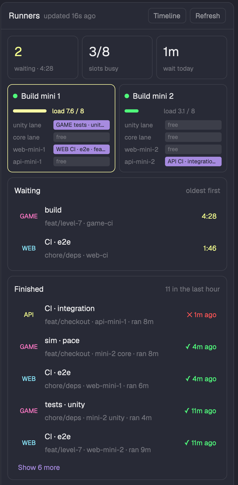

# Runners

A status-bar chip, a side-panel tab and an on-demand timeline window that show what waits for
self-hosted build machines, what runs on them, and how hard each one works: GitHub Actions runner
slots, the lanes of a lock-based job script, and each machine's load over ssh.

## What you see

- **Chip** (status row, weight 2.6, min 120 px): `Runners`, then one 6x12 px square per slot in
  groups per machine with 5 px between groups: `accent` = running, `border` = free, `surface` with
  a border = status unknown, `ansi1` = offline. Then `N waiting` in `ansi3`, `N running`, or `idle`
  in `dim`. Narrower than the full row it drops the title; narrower than the squares it shows
  `Runners busy/total · N waiting`.
- **Popup** (420 px, at the pointer, right-click on the chip): header `Runners`, `updated Ns ago`,
  Refresh. Groups `WAITING · n` (time waited in `ansi3`), `RUNNING · n` (elapsed / usual, a 3 px
  bar, amber past 1.2x usual), `MACHINES` (dot, `busy of slots`, 60 px load bar, `load x / cores`),
  at most 6 rows each. Footer: Open panel, Timeline.
- **Panel**: header with Timeline and Refresh; tiles for waiting (with the longest wait), slots
  busy, and today's median wait; a card per machine (load bar, optional `warm:` text, a 15 px bar
  per slot naming its job, a hot border at load per core >= 0.9); Waiting; Finished with the 5
  latest of the last hour and Show more. Without a config: a Set up card.
- **Timeline** (window 940 px, key `runners-lanes`): axis -30m to +10m, a 24 px lane per slot, grid
  every 5 min, an `accent` now line. Passed = `surface` with a 2 px `ansi2` left edge, failed the
  same in `ansi1`, running = `accent`, the usual rest = `accent` at 30%, waiting = dashed `ansi3`
  border at its expected start.

## How it behaves

Click the chip: show the panel (`layout.select` `panel-body` → `runners`, `layout.show` `panel`),
or hide it when it shows. A GitHub job opens on GitHub (https only); a lanes job opens its log
folder. Toasts: a job waiting past `waitAlertMinutes` (once per job), a slot going offline.

## Built from

`main.js` (picks the view from `props().view`: chip, popup, lanes, else panel), `poll.js` (one
shared snapshot `runners.v1`, a 45 s lock `runners.lock`, `runners.refresh`), `config.js`
(`runners.json`), `load.js` (`gh api` runs, jobs and runners; ssh load), `lanesource.js` (status
text and history JSONL), `demo.js`, `model.js` (pure: waiting, running, finished, usual lengths, the
plan of expected starts), `ui.js`, `chip.js`, `popup.js`, `panel.js`, `lanes.js`. Herdr: `exec`,
`readTextFile`, `shared`, `setShared`, `notify`, `openOverlay`, `closeOverlay`, `layout`, `run`,
`settings().zoom`.

## Watch out

- `on_size_change` reports screen pixels; divide by `settings().zoom` before comparing with layout
  sizes, or a zoomed window draws past its block.
- A popup sizes to its content: a `flex_1` body collapses to zero height. Cap it with `max_h`.
- A hot reload can cut off a read after it took the lock; the lock expires after 45 s.
- `actions/runners` needs repo admin; without it a slot's status is unknown until a job runs there.
- Write `mod.json` before `main.js` in a new mod folder, or Herdr docks a copy into the layout.
- Status-row blocks with fixed px push the last ones off a narrow window; use weights and `min`.

## Done when

`npm test` passes; `herdr-app check` passes; with `{ "demo": true }` the chip shows 8 squares and
`2 waiting`, the panel shows 2 machines, 2 waiting and 11 finished jobs, and the timeline places
both waiting jobs; clicking the chip twice shows and hides the panel; the timeline's Close button
closes it.
